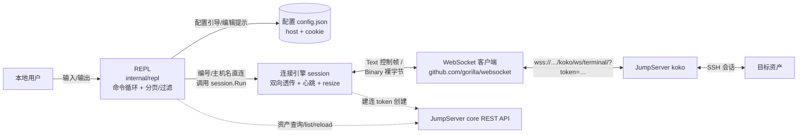
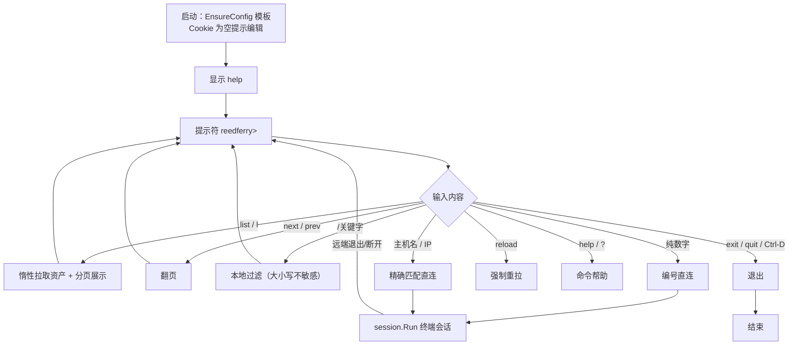
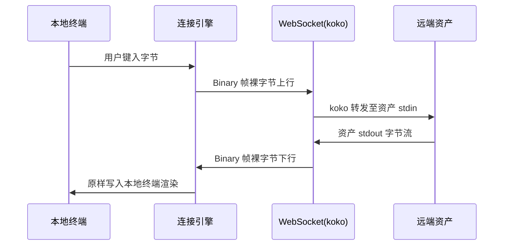

# Reedferry 详细设计

> 项目名 Reedferry 取自《诗经·卫风·河广》"谁谓河广？一苇杭之。"——以苇为舟，渡河不涉水；以 Web 为道，不依赖 SSH 直连。

# 版本修订记录

| 修订人 | 内容 | 修订时间 |
| --- | --- | --- |
| 设计助手（AI Agent） | 详细设计定稿：交互式 REPL、模块划分、WebSocket 协议（协议实测结论见附录 D） | 2026-08-13 |
| 开发（AI Agent） | 新增自动登录：程序内交互式登录换取会话 Cookie（含 2FA），登录流程实测结论见附录 D V5；新增 authui 模块 | 2026-09-04 |
| 开发（AI Agent） | 登录改为统一认证微信扫码（JumpServer 账号密码登录下线）：新增终端二维码渲染、免扫码续期（sso_cookie），删除账号密码加密链路 | 2026-11-10 |

# 1. 项目概述

## 1.1 项目背景

许多 JumpServer 部署只开放 Web 终端通道（443 WebSocket），不提供 SSH 直连端口，导致本地 `ssh` 无法直连 JumpServer 资产，JumpServer 官方客户端的 SSH 终端同样不可用；通常只提供浏览器 Web 终端（443 WebSocket 通道）。

Web 终端能力在线、审计链路完整，但浏览器终端缺少本地终端的手感（无本地快捷键、多标签、复制粘贴、终端复用工具等）。Reedferry 的目标是让本地终端借道 Web 通道连接 JumpServer 资产，找回本地终端手感，同时全程走 JumpServer 审计。

参考实现：[karin0/jumpserver-proxy](https://github.com/karin0/jumpserver-proxy)（开源项目，其 WebSocket 协议链路已验证可行），本项目对标其协议细节，但不采用其端口转发方案。

## 1.2 项目目标

按 SMART 拆解：

| 目标 | 衡量标准 |
| --- | --- |
| S1：本地终端可连 JumpServer 资产 | 进入 REPL 后输入编号或主机名即可进入远端 shell，输入输出即时回显 |
| S2：交互式 REPL | 直接运行 `reedferry` 进入交互模式：资产列表分页、关键字过滤、编号/主机名直连，无学习成本 |
| S3：认证双通道 | 会话 Cookie 支持两种来源：程序内交互式登录（账号密码 + 可选 2FA）自动写入配置；或手动复制浏览器会话 Cookie 粘贴（原有方式保留） |
| S4：审计链路不破坏 | 连接仍经 JumpServer koko Web 通道，审计记录与浏览器 Web 终端一致 |
| S5：单二进制交付 | `go build` 产出单个可执行文件，运行仅依赖目标机终端环境 |
| S6：协议问题显性化 | 对 API 路径/消息格式的版本差异给出待验证项与验证方法（见附录 D），降低实现风险 |

## 1.3 项目范围

**包含（In-Scope）：**

- 交互式 REPL：资产列表分页/过滤/编号直连、连接编排、配置引导、help/exit；
- 配置管理：自动创建示例配置模板、Cookie 为空时引导编辑 `config.json`；
- 终端连接：本地终端与 koko WebSocket 之间的双向数据通道，支持终端尺寸同步、保活心跳、优雅退出；
- 自动登录：Cookie 为空/失效时交互式输入账号密码（可选 2FA 动态验证码），登录成功自动把会话 Cookie 写入配置（0600 原子写）；
- 基础调试能力（`--debug` 打印收发消息）。

**不包含（Non-Goals）：**

- 端口转发 / 文件传输 / SFTP 等 Tunnel 能力（本期 KISS，后续可扩展）；
- 账号密码以外的认证逻辑扩展：不实现扫码/第三方登录（企业微信/钉钉/飞书/OpenID/CAS/SAML2/OAuth2）、不实现图形验证码自动识别、不实现国密（SM2/SM4）密码加密；这些场景提示用户改用浏览器登录复制 Cookie；
- 浏览器 Cookie 的自动提取（本期支持手动复制 Cookie 请求头与程序内登录两种方式）；
- 图形界面、系统托盘、守护进程常驻；
- 多平台打包（本期面向 macOS 本机，Go 交叉编译能力天然保留）。

# 2. 需求分析

## 2.1 功能需求

### FR-1 配置管理

- 首次运行：配置文件不存在时**自动创建示例模板**（占位 host + 空 cookie），提示用户编辑 `~/.config/reedferry/config.json`（权限 0600）；
- 配置存在但 Cookie 为空：启动时引导扫码登录（终端渲染统一认证微信二维码），也保留"编辑 <路径> 填入 Cookie"（浏览器登录后 F12 → Network → 任选请求 → 复制 Cookie 请求头）的原有方式；
- 编辑配置后输入 `reload` 或重启生效；Cookie 脱敏展示（仅前后 8 字符）供核验。

### FR-4 自动登录

- 触发时机：Cookie 为空（首次/清空）、或现有 Cookie 已失效（API 返回 401/302/403）时；REPL 内 `login` 命令可随时手动触发；
- 登录方式：JumpServer 认证已外抛给统一认证（CAS），程序内不接触账号密码——在终端渲染微信扫码二维码，用户用微信扫码并确认授权，程序轮询扫码状态并自动换票；
- 免扫码续期：登录同时保存统一认证域会话（`sso_cookie`）；业务会话过期时先带该会话静默换票，统一认证会话也过期才重新出二维码；
- 业务侧 2FA：若 JumpServer 仍对该账号要求 2FA，扫码完成后提示输入动态验证码（隐藏回显），验证码错误可重新输入（上限 3 次）；
- 成功后自动把业务域与统一认证域会话 Cookie 写入配置文件（沿用 0600 原子写），随后 list/连接资产直接可用；
- 失败区分：扫码取消 / 二维码过期（自动刷新，上限 3 次） / 微信未绑定账号 / 验证码错 / 网络不可达，给出可操作提示；
- 安全约束：程序内不接触账号密码；2FA 验证码与扫码输入不打印、不写日志、不落盘；登录流程不阻塞启动——用户取消、网络失败等均进入 REPL（可稍后 `login` 或手动粘贴 Cookie）。

### FR-2 资产列表

- `list` / `l`：拉取资产列表并以对齐表格展示（全局编号 + 主机名 + IP），**首次调用才拉取**（惰性），每页 10 条；
- `next` / `n`、`prev` / `p`：翻页（越界自动回卷）；
- `/关键字`：本地过滤（按主机名/IP 模糊匹配，**大小写不敏感**），输入 `/` 清除；
- `reload` / `r`：强制重新拉取资产；
- 会话无效（401/302/403）时自动触发重新登录；非失效错误给出明确提示，引导检查 Cookie。

### FR-3 终端连接

- `<编号>`：直接连接列表中对应资产（过滤后列表的全局序号）；
- `<主机名或IP>`：直接输入名称精确匹配连接（未拉取资产时先自动拉取）；
- 会话期间：本地终端进入 raw mode，输入以 Binary 裸字节上行，下行终端字节流原样渲染；
- 终端尺寸：进入时发送 `TERMINAL_INIT`；窗口尺寸变化（SIGWINCH）时发送 `TERMINAL_RESIZE`；
- 心跳：每 30s 发送应用层 `PING` 保活，防止 nginx 空闲断连；
- 退出：远端退出（CLOSE 消息/关闭帧）后恢复终端并**回到 REPL**；会话期间 Ctrl-D 作为字节透传；
- 断线：WebSocket 意外断开时提示原因，回到 REPL。

## 2.2 非功能需求

| 维度 | 要求 |
| --- | --- |
| 性能 | 数据通路低延迟透传（裸字节直发，无编解码开销）；终端输入延迟与浏览器 Web 终端同一量级（本地网络 <100ms 内回显） |
| 可用性 | 单二进制无外部依赖；Cookie 失效时自动重新登录，错误信息可操作（区分账号密码错/验证码错/网络不可达） |
| 安全 | Cookie 明文仅存本地 0600 配置；账号密码与 2FA 验证码不落盘不打印不写日志；全程走 TLS（wss://） |
| 可维护性 | 模块按 `internal/{config, jumpserver, terminal, session, repl}` 分层，单测覆盖编解码、协议、配置与 REPL 交互 |
| 兼容性 | 对标 JumpServer v3.x 部署（实测 `/core/auth/login/` 前缀佐证），协议差异项见附录 D 待验证清单 |

## 2.3 需求变更管理

项目变更由维护者直接决策；涉及协议/API 的变更需更新附录 D 待验证清单与"版本修订记录"，并同步更新 README。

# 3. 总体架构设计

## 3.1 系统架构图



**REPL 命令循环**：



**数据通路（连接态，v3 纯透传）**：



## 3.2 技术选型

| 组件 | 选型 | 依据 |
| --- | --- | --- |
| 语言 | Go 1.22+ | 单二进制、标准库网络能力强、跨平台编译 |
| WebSocket | github.com/gorilla/websocket | 与参考实现一致、社区最成熟、文档丰富 |
| 终端 | golang.org/x/term | raw mode、尺寸读取、SIGWINCH 监听、ReadPassword 隐藏回显（Go 官方扩展库；本期不启动本地 shell，故不引入 creack/pty） |
| 登录加密 | 标准库 crypto/{rsa,aes,rand} | RSA PKCS1v1.5 + AES/ECB/ZeroPadding（与 JumpServer 前端 session-encrypt.js / 后端 common/utils/crypto.py 对齐，见附录 D V5）；不引入第三方加密库 |
| 配置 | 标准库 encoding/json + os.UserHomeDir | 零依赖，`~/.config/reedferry/config.json`（XDG 风格，跨平台统一） |
| 日志 | 标准库 log | 调试信息输出到 stderr，不污染终端数据流 |

**明确不选**：smux / kcptun（参考实现的端口转发栈，Reedferry 不做转发，见 Non-Goals）。

# 4. 数据库设计

**不适用**：本项目无数据库。唯一持久化数据为本地配置文件 `~/.config/reedferry/config.json`，结构如下（见 5.2.1 config 模块）：

```json
{
  "host": "https://your-jumpserver.example.com",
  "cookie": "sessionid=xxxx; csrftoken=yyyy"
}
```

# 5. 功能模块设计

## 5.1 模块划分

```
reedferry/
├── cmd/reedferry/main.go        # 入口：无参数进入 REPL（带参数提示错误）
├── internal/
│   ├── repl/                    # 交互式 REPL：命令解析、分页/过滤、连接编排、登录编排
│   │   ├── repl.go              # 主循环、命令分发、输入模型、连接编排、自动登录
│   │   └── repl_test.go
│   ├── config/                  # 配置读写（模板创建、0600 原子写）
│   ├── authui/                  # 登录界面：账号/密码/2FA 验证码终端输入（隐藏回显）
│   ├── jumpserver/              # API 客户端 + WebSocket 协议适配 + 登录流程
│   │   ├── api.go               # REST：资产树、账号、建连 token
│   │   ├── login.go             # 登录流程：RSA/AES 密码加密、2FA、Cookie 提取（见附录 D V5）
│   │   ├── ws.go                # WebSocket 连接与消息收发
│   │   └── protocol.go          # 消息类型常量、JSON 编解码
│   ├── terminal/                # 终端管理（raw mode、尺寸、SIGWINCH resize 事件）
│   └── session/                 # 连接引擎（双向透传、心跳、退出、错误处理）
└── docs/design/                 # 设计文档
```

## 5.2 模块详细设计

### 5.2.1 模块 A：config（配置管理）

* **功能描述**

  管理 `~/.config/reedferry/config.json` 的读写。配置文件权限 0600，含 JumpServer 地址与浏览器会话 Cookie 串。配置不存在时自动创建示例模板（占位 host + 空 cookie），引导用户编辑。

* **接口设计**

  ```go
  // internal/config
  type Config struct {
      Host   string `json:"host"`   // 如 https://your-jumpserver.example.com
      Cookie string `json:"cookie"` // 浏览器会话 Cookie，如 "sessionid=xxx; jms_csrftoken=yyy"
  }
  func Load() (*Config, error)          // 不存在则返回 ErrNotConfigured
  func Save(c *Config) error            // 0600 原子写（先写临时文件再 rename）
  func EnsureConfig() (*Config, error)  // 不存在时创建示例模板并返回，已存在则读取
  func (c *Config) MaskedCookie() string // 脱敏：仅显示前后 8 字符
  func (c *Config) CSRF() string        // 从 Cookie 提取 jms_csrftoken（见附录 D V3）
  ```

* **逻辑流程**

  ```mermaid
  sequenceDiagram
      participant R as repl
      participant F as config.json
      R->>F: EnsureConfig（不存在 → 写示例模板）
      F-->>R: 模板 {host: 占位, cookie: ""}
      R->>R: Cookie 为空 → 引导交互式登录（或提示编辑 <路径> 填入 Cookie）
      R->>J: 登录：GET 登录页 → POST 表单（RSA/AES 加密密码）→ 302 guard
      J-->>R: （可选）2FA 挑战：输入动态验证码
      R->>J: POST code + mfa_type
      J-->>R: 会话 Cookie
      R->>F: 登录成功 → 自动写入新 Cookie（0600 原子写）
      R->>F: 用户编辑 host/cookie 后 reload
  ```

### 5.2.2 模块 B：jumpserver（API 客户端 + WebSocket 协议适配 + 登录流程）

* **功能描述**

  封装与 JumpServer 的全部交互：REST 查询资产与可用账号、创建建连 token、建立 koko WebSocket 通道、消息编解码（Text JSON 控制帧 + Binary 裸字节），以及程序内登录流程（统一认证微信扫码 + 业务侧可选 2FA，换取会话 Cookie）。登录实现细节与实探结论见附录 D V5。

* **接口设计**

  ```go
  // 登录流程（纯 HTTP 客户端，无浏览器依赖；CAS 扫码 + 可选业务侧 2FA，见附录 D V5）
  type LoginFlow struct{ ... }
  func NewLoginFlow(ctx, host, ssoCookie string) (*LoginFlow, *LoginOutcome, error)
      // 业务 CAS 入口（发现 SSO 域与 service）→ 带上次 SSO 会话静默换票，或拉取扫码二维码
  func (f *LoginFlow) QR() *QRCode          // 二维码内容（统一认证扫码入口 URL）
  func (f *LoginFlow) RefreshQR(ctx) error  // 二维码过期刷新（同一扫码会话，令牌不变）
  func (f *LoginFlow) PollScan(ctx) (ScanStatus, *LoginOutcome, error)
      // 轮询扫码状态：LOGINING（已扫码待授权）/ LOGINED（完成）/ QUIT_LOGIN / ACCOUNT_BIND / EXPIRED
      // LOGINED → dologin 确认 →（隐私协议分支）→ CAS 表单 _eventId=scanCodeLogin
      // → 302 service?ticket=… → ticket 回跳业务侧 →（可选 MFA）→ 落地页取 CSRF → Cookie
  func (f *LoginFlow) SubmitMFA(ctx, code, mfaType string) (*LoginOutcome, error)
      // POST /core/auth/login/mfa/（业务侧 2FA，表单 csrfmiddlewaretoken/code/mfa_type）
      // 错 → LoginErrBadMFA
  type LoginOutcome struct {
      Cookie    string     // 业务域会话 Cookie（写入配置 cookie）
      SSOCookie string     // 统一认证域会话 Cookie（写入配置 sso_cookie，免扫码续期）
      NeedQR    bool       // 待展示二维码
      NeedMFA   bool       // 待输入业务侧 2FA 验证码
      QR        *QRCode    // NeedQR 时的扫码挑战（content/token/version）
      Prompt    *MFAPrompt // NeedMFA 时的可用验证方式（type/label）
  }
  type LoginError struct{ Kind LoginErrorKind; Msg string } // 错误分类（验证码错/扫码取消/二维码过期/需绑定账号）
  ```

  ```go
  // REST（带 Cookie 的 GET；路径为 JumpServer v3 实测结果，见附录 D V1/V2）
  type Asset struct {
      ID           string // 资产 UUID（树叶子节点 id）
      Hostname     string // 主机名（节点 name）
      Address      string // IP 地址（节点 title，缺失时回退 meta.data.address）
      // 扩展字段来自 meta.data（platform_type/org_name），容错解析缺失置空
      PlatformType string
      OrgName      string
  }
  type SystemUser struct {
      ID         string `json:"id"` // 账号 id（= alias，用作 connection-token 的 account）
      Name       string `json:"name"`
      Username   string `json:"username"`
      SecretType string `json:"secret_type"`
  }

  func ListAssets(ctx, host, cookie string) ([]Asset, error)
      // GET {host}/api/v1/perms/users/self/nodes/children-with-assets/tree/
      // 无 key 返回根节点；带 key={节点id} 返回子节点+资产（逐层展开）；
      // BFS 收集 meta.type='asset' 叶子；参数名是 key 而非 id（?id= 会 500）
      // 见附录 D V1；注：以 host/cookie 字符串传参，避免 config↔jumpserver 循环依赖
  func ListSystemUsers(ctx, host, cookie, assetID string) ([]SystemUser, error)
      // GET {host}/api/v1/perms/users/self/assets/{assetID}/
      // 解析 permed_accounts 数组；取数组首个为默认；见附录 D V2

  // WebSocket（v3 实测流程：先建 token 再以 ?token={id} 握手，见附录 D V3）
  func CreateConnectToken(ctx, host, cookie, csrf, assetID, account string) (*ConnectToken, error)
      // POST {host}/api/v1/authentication/connection-token/
      // 头：Cookie + X-CSRFToken（值为 cookie 中的 jms_csrftoken，JumpServer 自定义 cookie 名）
      // 体：{asset, account(permed_accounts 的 alias=id), protocol:"ssh", input_username:"",
      //      input_secret:"", input_secret_type:"password", connect_method:"web", connect_options:{}}
      // 返回 201 + {id, value}
  func Connect(ctx, host, cookie, tokenID string) (*Conn, error)
      // wss 握手：wss://{host}/koko/ws/terminal/?token={token.id}
      // 握手 Header 携带 Cookie；TLS 校验证书（如 JumpServer 使用自签证书导致校验失败，再评估跳过开关）
      // 注：同 REST，host/cookie 字符串传参避免循环依赖
  ```

  消息协议（v3 纯透传实测，见附录 D V3）：

  | 方向 | type | 帧类型 | data 字段 | 说明 |
  | --- | --- | --- | --- | --- |
  | 下行 | `CONNECT` | Text JSON | —（含 `id` 字段） | 连接就绪，返回会话 id |
  | 下行 | `TERMINAL_SESSION` | Text JSON | — | 会话信息（忽略即可） |
  | 上行 | `TERMINAL_INIT` | Text JSON | `{"cols":N,"rows":N}` | 告知终端尺寸，收到 CONNECT 后立即发送 |
  | 上行/下行 | 终端字节 | **Binary 裸字节** | 原样字节流 | v3 纯透传：终端输入/输出直接以裸字节发送，**非 hex 编码**（参考实现的 JSON+hex 编码不适用，实测上行 hex 不生效） |
  | 上行 | `TERMINAL_RESIZE` | Text JSON | `{"cols":N,"rows":N}` | 窗口尺寸变化 |
  | 上行 | `PING` | Text JSON | 空字符串 | 30s 心跳保活 |
  | 下行 | `CLOSE` | Text JSON | —（含 `msg` 字段） | **会话结束信号**（实测：exit 后 koko 发 Text JSON CLOSE 消息，而非 WebSocket 关闭帧；收到即正常退出） |

  上行控制消息统一携带 `id`（取自 CONNECT 消息返回的 `id`）。

  **v3 纯透传帧类型**：Text 帧（opcode=1）= JSON 控制消息；Binary 帧（opcode=2）= 裸终端字节流。参考实现 karin0/jumpserver-proxy 的 "JSON+hex" 编码完全不适用于 v3。

* **逻辑流程**

  ```mermaid
  sequenceDiagram
      participant S as session
      participant A as api.go
      participant K as koko ws
      S->>A: 查资产 target_id（UUID 直传，由 repl 匹配）
      S->>A: 查账号（permed_accounts，缺省取首个）
      S->>A: POST connection-token（X-CSRFToken=jms_csrftoken + Referer）
      S->>K: wss 握手 ?token={id}（Cookie）
      K-->>S: CONNECT {id}（Text JSON）
      S->>K: TERMINAL_INIT {cols,rows}（Text JSON）
      Note over S,K: 双向透传：Binary 裸字节终端流 + 30s PING + RESIZE（Text JSON）
  ```

* **边界与异常**

  - API 非 200：按状态码给提示（401/302/403 会话失效 → REPL 层自动重新登录，见 5.2.5；404 → 见附录 D 排查）；
  - 资产不存在/无可用账号：明确报错退出；
  - WS 握手失败：区分网络不可达 / Cookie 无效（302 到登录页）；
  - 请求超时兜底：所有 API 请求带 15s 超时（context.WithTimeout + http.Client.Timeout 双层），body 读取在 cancel 前完成，杜绝挂起。

### 5.2.3 模块 C：terminal（终端管理）

* **功能描述**

  本地终端进入 raw mode 并作为尺寸来源。数据透传直接使用 os.Stdin/os.Stdout，
  不启动本地 shell 进程——若启动，本地 shell 的回显/渲染会混入上行字节流污染远端
  会话（见 5.2.4 纯透传说明），故终端模块仅承担 raw mode 与尺寸读取。

* **接口设计**

  ```go
  type PTY struct {
      F *os.File       // 本地终端文件（交互场景为 os.Stdin）
  }
  func Open(shell string) (*PTY, error)  // raw mode + 读取尺寸；shell 参数预留（本期不启动本地 shell）
  func (p *PTY) WatchSize(fn func(cols, rows int)) // 监听 SIGWINCH，尺寸变化由 session 发 TERMINAL_RESIZE
  func (p *PTY) Restore()                // 恢复终端模式（defer 保证）
  ```

* **逻辑流程**

  置 raw mode → 读取本地终端尺寸；session 从输入通道读字节、向 os.Stdout
  写输出字节（双向透传见 5.2.4）；SIGWINCH → 读新尺寸 → 回调 session 发
  `TERMINAL_RESIZE`；会话结束 → 恢复终端模式（defer 保证）。

### 5.2.4 模块 D：session（连接引擎）

* **功能描述**

  编排 terminal 与 jumpserver 两条数据通路，实现双向透传、心跳、退出与错误收敛。**与参考实现的本质区别**：参考实现为端口转发在远端 `exec` 服务器程序并用 smux 复用连接，还因 shell echo 噪声对字符做了过滤（`\r \n ! , ?`）；Reedferry 为纯终端透传，**不执行远端程序、不做 smux、不过滤任何字符**——所有字节原样双向搬运，由本地终端负责渲染（终端控制序列直接写 os.Stdout，远端 shell 负责 echo）。

* **接口设计**

  ```go
  type Options struct {
      Debug       bool        // 打印收发消息（stderr）
      Input       io.Reader   // 本地输入；REPL 传入会话 channel 适配器
      Output      io.Writer   // 本地输出；默认 os.Stdout
      Term        Terminal    // 终端抽象；默认 terminal.Open，测试可注入
      HeartbeatInterval time.Duration // 心跳间隔；<=0 用默认 30s
  }
  func Run(ctx context.Context, cfg *config.Config, targetID string, opts Options) error
      // 建 WS（token）→ 本地终端 raw mode → CONNECT 后发 INIT → 双向搬运 → 心跳 → 退出清理
  ```

* **逻辑流程**

  ```mermaid
  sequenceDiagram
      participant R as repl
      participant S as session
      participant P as 本地终端
      participant K as koko
      R->>S: Run(资产 UUID)
      S->>S: 创建建连 token → wss 握手
      K-->>S: CONNECT {id}（Text JSON）
      S->>S: 本地终端进入 raw mode
      S->>K: TERMINAL_INIT(本地尺寸)
      loop 连接态
          P->>S: 输入字节 → Binary 裸字节上行
          K->>S: Binary 裸字节下行 → 写入本地终端
          Note over S: 每 30s PING；SIGWINCH → RESIZE
      end
      alt 远端退出（CLOSE 消息 / 关闭帧）
          S->>R: 恢复终端，正常返回
      else 意外断开
          S->>R: 恢复终端，返回错误提示
      end
  ```

* **异常处理**

  - 非法 Text 帧（无法解析的 JSON）：`--debug` 下打印原文并跳过，不 panic；
  - WS 读错误：区分正常关闭（CLOSE 消息 / 关闭帧）与异常断开；
  - 退出收敛：所有返回路径统一关闭连接并通知上行 goroutine 停止，避免泄漏的读输入者；
  - 上行写入失败即终止会话。

### 5.2.5 模块 E：repl（交互式 REPL）

* **功能描述**

  交互式命令循环：资产列表分页/过滤、编号/主机名直连、配置引导、help/exit。负责调用 session.Run 完成终端会话编排。

* **命令集**

  | 命令 | 说明 |
  | --- | --- |
  | `list` / `l` | 显示资产列表（首次调用惰性拉取，每页 10 条，行首为全局编号） |
  | `next` / `n`、`prev` / `p` | 下一页 / 上一页（越界自动回卷） |
  | `/关键字` | 本地过滤：按主机名/IP 模糊匹配（大小写不敏感）；输入 `/` 清除 |
  | `<编号>` | 直接连接列表中的资产（过滤后列表的全局序号） |
  | `<主机名或IP>` | 直接输入名称精确匹配连接（未拉取时先自动拉取） |
  | `reload` / `r` | 强制重新拉取资产（编辑配置后生效） |
  | `login` | 交互式重新登录（输入账号密码，可选 2FA，成功后自动更新会话 Cookie） |
  | `help` / `?` | 显示全部命令帮助 |
  | `exit` / `quit` / `Ctrl-D` | 退出（REPL 为正常行输入模式，Ctrl-D 行首 = EOF） |

* **输入模型**

  会话与 REPL 共用同一 stdin，为避免会话结束后泄漏的输入读取者与 REPL 竞争抢读
  （回 REPL 后首次输入被吞），采用**唯一 stdin 读取者 + 模式分发**：

  - 唯一 stdin 读 goroutine 把字节投递到原始 channel；
  - 分发 goroutine 按当前模式转发：命令模式 → 命令 channel（REPL 消费）；会话模式 → 会话 channel（session 消费）；
  - 会话结束分发不再发会话 channel，泄漏的上行 goroutine 阻塞在 channel 接收而非 fd 读取，不再与 REPL 竞争。

* **配置引导与自动登录**

  - 启动 `EnsureConfig`：无配置则创建示例模板（占位 host + 空 cookie）并提示编辑路径；
  - Cookie 为空或已失效（401/302/403）：进入交互式登录——提示输入账号/密码（密码隐藏回显），系统要求 2FA 时输入 JumpServer 2FA 动态验证码，成功后把新 Cookie 写入配置（0600 原子写）；
  - 登录流程不阻塞启动：用户取消（Ctrl-D）、网络失败、登录失败均打印提示后进入 REPL，可稍后 `login` 或手动粘贴 Cookie；
  - `list` 在 Cookie 为空时提示先编辑配置或登录；`reload` 强制重拉；API 会话失效时自动重新登录并重试。

* **接口设计**

  ```go
  func Run() error                          // 启动 REPL（EnsureConfig → 按需登录 → help → 命令循环）
  func (r *REPL) runCommand(line string) error // 命令分发；errQuit 表示退出
  func (r *REPL) loginIfNeeded() error      // 启动时 Cookie 为空/失效 → 交互式登录（不阻塞启动）
  func (r *REPL) interactiveLogin() (bool, error) // 登录编排（账号/密码/2FA + 写配置 + 清资产缓存）
  func (r *REPL) maybeRelogin(err error) bool // APIError(401/302/403) → 重新登录，成功返回 true
  // 测试可注入：connect（默认调 session.Run）、login（默认真实登录流程）、分页/过滤为纯方法
  ```

### 5.2.6 模块 F：authui（登录界面）

* **功能描述**

  提供交互式登录的用户界面：账号/密码/2FA 验证码的终端输入与结果提示。密码与验证码输入隐藏回显（golang.org/x/term.ReadPassword），输入内容仅存于本次调用栈，不打印、不写日志、不落盘（见 7.1）。

* **接口设计**

  ```go
  // internal/authui
  func ReadCredentials(in io.Reader, out io.Writer) (username, password string, err error)
      // 提示输入账号与密码（密码隐藏回显）；stdin 非 TTY 或 EOF(Ctrl-D) 返回错误由调用方按取消处理
  func RunMFA(ctx context.Context, flow *jumpserver.LoginFlow, prompt *jumpserver.MFAPrompt, in io.Reader, out io.Writer) (*jumpserver.LoginOutcome, error)
      // 提示"请输入 JumpServer 2FA 动态验证码（方式）"，验证码错误可重试（上限 3 次）
  var ErrNotTTY = errors.New("登录需要交互式终端...")
  ```

# 6. 系统集成设计

## 6.1 第三方接口集成

### 6.1.1 JumpServer REST API（认证双通道）

| 项 | 说明 |
| --- | --- |
| 认证方式 | 请求头 `Cookie: jms_sessionid=...; jms_csrftoken=...`（程序内扫码登录或浏览器会话两种来源），无令牌刷新逻辑；CSRF 头 `X-CSRFToken` 取 cookie 中的 `jms_csrftoken`（JumpServer 自定义 cookie 名，非 Django 默认 csrftoken） |
| 登录流程 | 程序内扫码登录：业务 CAS 入口 → 统一认证微信扫码（轮询 → 换票）→ ticket 回跳业务侧 →（可选）2FA 动态验证码 → 落地页取 CSRF → 提取会话 Cookie；细节与实探结论见附录 D V5 |
| 资产列表 | `GET {host}/api/v1/perms/users/self/nodes/children-with-assets/tree/`（无 key 返回根节点，带 `key={节点id}` 逐层展开，BFS 收集资产叶子；v3 实测） |
| 系统用户 | `GET {host}/api/v1/perms/users/self/assets/{asset_id}/`（解析 `permed_accounts` 数组，账号 id/alias 作 token 的 account；v3 实测） |
| 建连 token | `POST {host}/api/v1/authentication/connection-token/`（头带 `Cookie` + `X-CSRFToken` + `Referer`；体含 asset/account/protocol 等，返回 201 `{id, value}`；v3 实测，见附录 D V3） |
| 重试机制 | 网络类错误最多重试 1 次（间隔 500ms）；4xx 不重试，直接归类错误 |
| 失效判定 | HTTP 401 / 302→登录页 / 403 判定为会话失效，提示重新登录（自动触发）或检查 Cookie（编辑 config.json 后 reload） |

### 6.1.2 koko WebSocket 通道

| 项 | 说明 |
| --- | --- |
| 前置 | `POST {host}/api/v1/authentication/connection-token/` 创建建连 token（头 `Cookie` + `X-CSRFToken`=cookie 中 `jms_csrftoken`；返回 201 `{id, value}`；v3 实测，见附录 D V3） |
| 端点 | `wss://{host}/koko/ws/terminal/?token={token.id}`（v3 实测；旧 `target_id`+`system_user_id` 参数会收到 ERROR "connect token is nil"） |
| 握手 | 请求头 `Cookie: ...`；协议 `Sec-WebSocket-Protocol` 按 koko 要求（若实测需要） |
| 消息 | **Text 帧 = JSON 控制消息**（CONNECT/TERMINAL_SESSION/上行 INIT/RESIZE/PING）；**Binary 帧 = 裸终端字节流**（下行 shell 输出原样下发、上行输入裸字节直发；v3 纯透传，非 JSON 包裹/hex 编码，见 5.2.2 协议表） |
| 保活 | 应用层 `PING`（JSON 消息 `{type:"PING"}`，与参考实现 `writePing` 一致）每 30s 发送，防 nginx 空闲断连。注意：此 PING 为 JumpServer 应用层消息，与 WebSocket 协议层的 ping/pong 控制帧无关；gorilla `SetPongHandler` 只处理协议层 pong 帧（koko 不下发协议层 ping 时不会触发），不作为保活依据 |
| 关闭 | 正常：对端发 **Text JSON `CLOSE` 消息**（实测 exit 后 koko 行为）或 WebSocket 关闭帧，二者均按正常退出；本地主动退出：发关闭帧后 Close |

## 6.2 内部模块集成

```
repl     ──调用──> session（终端会话编排）
repl     ──调用──> jumpserver（资产/账号查询 + 登录流程 LoginFlow）
repl     ──调用──> authui（登录输入：账号/密码/2FA 隐藏回显）
repl     ──调用──> config（EnsureConfig / Load / Save）
session  ──调用──> jumpserver（API + WS）
session  ──调用──> terminal（终端：raw mode / 尺寸 / resize 事件）
config   ──调用──> jumpserver（无——校验由 repl/session 完成，避免循环依赖）
```

调用链单向、无环；所有网络 I/O 收敛在 `jumpserver` 包，所有终端 I/O 收敛在 `terminal`/`authui` 包，`repl` 为交互编排层，`session` 为连接引擎层，均便于单测与 mock。

## 6.3 中间件集成

不适用：无 MQ / Redis 等中间件。

# 7. 系统安全设计

## 7.1 安全架构与机制

| 项 | 方案 |
| --- | --- |
| 身份认证 | 会话 Cookie 两种来源：程序内扫码登录（统一认证微信扫码 + 可选业务侧 2FA，见附录 D V5）或手动复制浏览器会话 Cookie；程序内不接触账号密码 |
| 凭据安全 | 程序内不收集账号密码；2FA 验证码仅存于本次调用栈（隐藏回显、不打印、不写日志、不落盘）；业务域与统一认证域会话 Cookie 分开存储、分开发送 |
| 传输加密 | 全程 TLS（wss:// 与 https://）；证书校验保持开启，如 JumpServer 使用自签证书导致 TLS 校验失败时，评估显式 `--insecure` 开关（默认关闭） |
| 本地存储 | Cookie 写入 `~/.config/reedferry/config.json`，文件权限 0600；展示时脱敏（仅前后 8 字符） |
| 审计 | 连接链路与浏览器 Web 终端完全一致（同 koko、同系统用户），JumpServer 侧审计记录天然生效，Reedferry 不做旁路 |
| 数据安全 | 终端会话内容不落盘、不写日志（`--debug` 仅打印到 stderr） |

## 7.2 漏洞管理

- 输入注入：REPL 命令仅作字符串匹配（主机名/IP 精确匹配、编号索引），不拼接 shell 命令；
- Cookie 泄露面：仅存本机 0600 文件，提示用户"Cookie 含登录凭据，勿提交至版本库"（README 同步提示）；
- 依赖更新：gorilla/websocket、golang.org/x/term、rsc.io/qr 保持最新稳定版，`go mod tidy` 定期执行。

# 8. 项目实施计划

## 8.1 资源分配

| 资源 | 说明 |
| --- | --- |
| 人力 | 开发者 1 人 |
| 硬件 | 本机 macOS（开发与验收） |
| 网络 | JumpServer 地址需网络可达（HTTPS 443） |
| 依赖 | Go 工具链 + 两个第三方库（gorilla/websocket、golang.org/x/term） |

## 8.2 任务拆解与进度

| # | 任务 | 产出 | 依赖 | 预计工时 |
| --- | --- | --- | --- | --- |
| T1 | 项目脚手架：go.mod、目录结构、REPL 入口 | `cmd/reedferry/main.go` | — | 0.5d |
| T2 | config 模块：模板创建、读写、脱敏 | `internal/config` | T1 | 0.5d |
| T3 | jumpserver：资产树/账号/建连 token API + WS 通道 | `internal/jumpserver` | T2 | 1d |
| T4 | 待验证项实测（带 Cookie 验证 API 路径与协议，见附录 D） | 验证结论，必要时调整 api.go/ws.go | T3 | 0.5d |
| T5 | session 连接引擎：raw mode + 双向透传 + 心跳 + 退出收敛 | `internal/session`、`internal/terminal` | T3/T4 | 1.5d |
| T6 | REPL：命令循环、分页/过滤、编号/主机名直连、配置引导 | `internal/repl` | T5 | 1d |
| T7 | 测试：单元（编解码/协议/配置/REPL）+ 手工验收 | 见第 9 章 | T6 | 1d |
| T8 | README 使用说明更新 | README | T7 | 0.5d |

**里程碑**：M1（T3 完成，资产 API 可用）→ M2（T5 完成，可进入 shell）→ M3（T7 完成，可交付）。

# 9. 测试计划

## 9.1 测试策略与环境

| 类型 | 范围 | 工具 |
| --- | --- | --- |
| 单元测试 | hex 编解码、协议消息编解码、配置读写（含 0600/原子写/模板创建）、JSON 解析容错、REPL 命令解析/分页/过滤/编号 | `go test` |
| 集成测试 | mock WebSocket 服务端（本地 fake koko：Text 控制帧 + Binary 裸字节 + CLOSE 消息），验证握手、消息序列、resize、心跳、退出 | `go test` + gorilla/websocket 回环 |
| 手工验收 | 真实连接 JumpServer 资产（REPL 内直连） | 本机终端 |

## 9.2 测试用例设计

| 用例 | 步骤 | 期望 |
| --- | --- | --- |
| U1 hex 编解码往返 | 随机字节 → Encode → Decode | 与原文一致 |
| U2 配置原子写 | 写入后检查文件权限 | 0600，无临时文件残留 |
| U3 协议解析 | 构造 CONNECT / Text 控制消息 / 非法 JSON | 正确识别 / 跳过不 panic |
| U4 mock 握手 | fake koko 收到握手 → 发 CONNECT | 客户端回 TERMINAL_INIT 且尺寸正确 |
| U5 透传回显 | fake koko Binary 回环 echo | 本地键入字符即时回显 |
| U6 resize | 调整窗口大小 | 收到 TERMINAL_RESIZE 且 cols/rows 正确 |
| U7 心跳 | 30s 静默 | 每 30s 收到 PING |
| U8 远端退出 | fake koko 发 CLOSE 消息 | 客户端正常返回，会话收敛无泄漏 |
| U9 异常断开 | 直接断开 TCP | 明确错误提示，恢复终端 |
| R1 REPL 命令解析 | 输入 list/next/prev//关键字/数字/主机名/exit | 正确分发与报错 |
| R2 分页边界 | 构造 25 条资产翻页 | 每页 10 条、越界回卷 |
| R3 过滤 | 大小写混合主机名 | 大小写不敏感匹配 |
| R4 配置模板 | 无配置启动 | 自动创建模板并提示编辑 |
| V1/V2 真实 API | 带 Cookie curl 资产树与账号 API | 见附录 D，结果为 200 或按排查流程调整 |
| V3 真实连接 | REPL 内连接真实资产 | 进入 shell，操作正常，JumpServer 审计有记录 |

## 9.3 缺陷管理

缺陷按严重级直接修复并回归：阻塞（无法连接）> 功能（resize/心跳失效）> 体验（提示不清）。回归策略：修复后重跑受影响用例（U1-U9 与 R1-R4 全量成本低，全部重跑）。

# 10. 部署方案

## 10.1 部署流程

单二进制交付：`go build -o ~/reedferry/reedferry ./cmd/reedferry`。首次运行自动创建示例配置模板，编辑 `~/.config/reedferry/config.json` 填入 host 后重启，程序内交互式登录（输入账号密码，可选 2FA）自动写入 Cookie；也可手动粘贴浏览器 Cookie（原有方式，浏览器登录后 F12 → Network → 复制 Cookie 请求头）。更新：重新 build 覆盖二进制即可，配置保留。

## 10.2 监控与告警

不适用（个人终端工具，无常驻服务）。`list` 可作为会话有效性自检手段。

## 10.3 故障处理

| 故障 | 处置 |
| --- | --- |
| Cookie 过期（401/302/403） | 程序自动重新登录；也可 REPL 内 `login` 或编辑配置文件重新粘贴 Cookie 后 `reload` |
| 登录失败（账号密码错） | 提示后重新输入（最多 3 次）；连续失败可稍后重试（JumpServer 有失败计数锁定） |
| 2FA 验证码错 | 提示重新输入（最多 3 次） |
| 网络不可达 | 检查 host 地址与网络；进入 REPL 后由 list 报错提示 |
| 扫码/第三方登录环境 | 程序内无法完成，改用浏览器登录后复制 Cookie（见附录 D V5） |
| API 404 | 按附录 D 待验证项排查流程处理 |
| WS 断连 | 重新输入编号/主机名连接；网络抖动则稍后重试 |

# 11. 用户培训与对接

单用户工具，README 提供 30 秒上手说明：运行 `reedferry` → 编辑 config.json 填入 host → 程序内交互式登录（或手动粘贴 Cookie）→ `list` → 输入编号连接。对接方为 JumpServer 部署管理员：需确认 443 WebSocket 通道与权限策略保持可用（浏览器 Web 终端可用即可）。

# 12. 附录

## 附录 A：术语表

| 术语 | 说明 |
| --- | --- |
| JumpServer | 开源堡垒机，含 core（REST API）与 koko（Web 终端/SSH 组件） |
| koko | JumpServer 的 WebSocket 终端服务组件，负责 Web 终端与目标资产间的会话 |
| 资产（Asset） | 可被连接的服务器主机 |
| 系统用户（System User） | 资产上实际使用的登录账号（root/admin 等），由 JumpServer 托管密码/密钥 |
| PTY | 伪终端（Pseudo-Terminal），本地终端程序与 shell 之间的通道 |
| Cookie | 浏览器登录会话凭据（sessionid 等），Reedferry 复用它完成 API 与 WS 鉴权 |

## 附录 B：参考文献

- 参考实现：karin0/jumpserver-proxy（https://github.com/karin0/jumpserver-proxy ），协议链路验证依据：`cmd/client/web.go`（API 路径、WS 端点与握手）、`cmd/client/console-stream.go`（hex 编解码）、`cmd/client/main.go`（CONNECT/TERMINAL_INIT/TERMINAL_DATA/TERMINAL_RESIZE/PING 消息时序）。开发期曾将源码镜像至本地 /tmp 目录便于对标，该路径非持久，以 GitHub 为准。
- gorilla/websocket：https://github.com/gorilla/websocket
- golang.org/x/term：https://pkg.go.dev/golang.org/x/term（raw mode / 尺寸 / SIGWINCH；creack/pty 本期未引入）

## 附录 C：重要事项记录

| 时间 | 主题 | 参与人员 | 要点&结论 |
| --- | --- | --- | --- |
| 2026-08-13 | 需求澄清 | 设计助手（AI Agent）、用户 | 交互式 REPL 定位与 Non-Goals 拍板（结论已落入正文各章节） |
| 2026-08-13 | 协议实测 | 用户、设计助手（AI Agent） | 资产树/账号/建连 token 端点与纯透传协议实测确认，结论见附录 D V1-V3 |
| 2026-09-04 | 登录流程实测 | 开发（AI Agent） | 登录页/表单/302 链/MFA 页结构实测确认，结论见附录 D V5（含国密与第三方登录的未支持结论） |

## 附录 D：待验证项清单（重点）

以下项在开发期必须实测确认，结论需回填至本表并同步更新代码。

### V1：资产列表 API 路径（实测结论）

**结论（带 Cookie 实测）**：旧路径 `/api/v1/perms/users/assets/` 返回 404 HTML 不适用。真实端点：

- `GET /api/v1/perms/users/self/nodes/children-with-assets/tree/`
- 无参数调用返回根节点列表；带 `key={节点id}` 返回该节点子节点+资产（逐层展开）
- 节点响应结构：`{id, name, title, pId, isParent, open, meta:{type, data}}`
  - `meta.type='node'`：分组节点，可继续用 `key` 展开
  - `meta.type='asset'`：资产叶子——`id`=资产 UUID、`name`=主机名、`title`=IP地址、`meta.data`={platform_type, org_name, sftp, name, address}
- **重要：查询参数名是 `key` 不是 `id`**（autoParam 将 id 映射为 key）；用 `?id=1` 会 500

**代码落点**：`internal/jumpserver/api.go` `ListAssets` 按此结构 BFS 逐层展开收集资产叶子（防环）；`Asset` = {ID, Hostname, Address(title), PlatformType, OrgName}。

**探测对照（无 Cookie）**：

| 探测（均无 Cookie） | 结果 | 判读 |
| --- | --- | --- |
| `/api/v1/perms/users/assets/` | 404 HTML | 路径不适用（已证实） |
| `/api/v1/users/profile/` | 401 JSON | DRF 标准未认证返回 |
| `/koko/ws/terminal/` | 302 → `/core/auth/login/` | koko 需鉴权；`/core/` 前缀佐证部署为 **JumpServer v3.x** |

**排查方法（V1.1，未来版本路径再变化时参考）**：

1. **从 Luna 前端 JS 确认实际 API**：浏览器打开任一资产 Web 终端页面，DevTools → Network 过滤 `api`，观察页面加载/资产列表时实际请求的 URL；比对 Network 中 XHR 的完整路径与 query 参数；
2. **API 文档对照**：访问 `https://your-jumpserver.example.com/api/docs/`（DRF Swagger，v3 亦可用），在 Permissions/Assets 相关 tag 下检索"User Asset"类 endpoint，记录真实路径与参数；
3. **抓包/浏览器 Network 直接录**：在浏览器 Web 终端执行一次连接，记录 koko ws 握手 URL 中的 `target_id` 来源接口，反推资产查询 API；
4. **回填结论**：将实测路径写入 `internal/jumpserver/api.go`，并更新本表。

### V2：系统用户 API 路径（实测结论）

**结论（带 Cookie 实测）**：旧路径 `/api/v1/perms/users/assets/{id}/system-users/` 返回 404 不适用。真实端点：

- `GET /api/v1/perms/users/self/assets/{asset_id}/`
- 响应 `permed_accounts` 数组即可用账号：`{id, name, username, secret_type, ...}`
- 账号 `id`（= alias）用作 connection-token 请求体的 `account` 字段（见附录 D V3）

**代码落点**：`internal/jumpserver/api.go` `ListSystemUsers` 解析 permed_accounts。

（未来版本路径再变化时的排查方法见 V1.1，不再赘述）

### V3：WebSocket 消息协议与建连流程（实测结论）

**结论（浏览器/独立 Python 客户端抓帧实测）**：连接后的消息协议与参考实现一致（CONNECT/TERMINAL_INIT/TERMINAL_DATA/TERMINAL_RESIZE/PING，上行携带 id），但**建连流程与参考实现完全不同**：

1. **建连第一步——创建 token**：`POST /api/v1/authentication/connection-token/`
   - 必须带 CSRF 头：`X-CSRFToken` 的值是 cookie 里的 **jms_csrftoken**（JumpServer 自定义 cookie 名；用 csrftoken 会报 'token from header incorrect'）
   - 还必须带 **Referer 头**：值为 `{host}/`（如 `https://your-jumpserver.example.com/`）。JumpServer 的 CSRF 保护除 X-CSRFToken 外还校验 Referer，缺省会报 403 'Referer checking failed - no Referer'；Go 的 http.Client 默认不发 Referer，浏览器请求天然携带故无此问题
   - 请求体：`{asset: 资产UUID, account: 账号alias(实测 alias=id), protocol: "ssh", input_username: "", input_secret: "", input_secret_type: "password", connect_method: "web", connect_options: {}}`
   - 返回 201：`{id, value, ...}`
2. **建连第二步——WebSocket 握手**：`wss://{host}/koko/ws/terminal/?token={token.id}`
   - 不再用 `target_id` + `system_user_id` 参数；v3 用 token 认证，旧参数会收到 ERROR "connect token is nil"
   - 握手 Header 仍带 Cookie
3. **连接后消息协议为 v3 纯透传**（浏览器/独立 Python 客户端抓帧确认）：
   - 下行 **Text 帧（opcode=1）** = JSON 控制消息：`{"id":"...","type":"CONNECT","data":"..."}`、`TERMINAL_SESSION` 等
   - 下行 **Binary 帧（opcode=2）** = **裸终端字节流**：直接是 shell 输出（banner、提示符、OSC 标题序列），**不是 JSON 包裹的 hex**
   - 上行 **Binary 帧** = 裸字节直接发送（echo `T1\r` 实测成功执行）；上行 Text JSON（hex 编码）**实测不生效**
   - 上行控制消息用 Text JSON 帧（TERMINAL_INIT/RESIZE/PING）实测有效
   - **退出信号**：exit 后 koko 发送 Text JSON 控制消息 `{"id":"...","type":"CLOSE","data":"","msg":"logout"}`，**不是** WebSocket Close 帧——客户端收到 CLOSE 即正常退出（若只等关闭帧会永久阻塞）
   - 参考实现 karin0/jumpserver-proxy 的 "JSON+hex" 编码**完全不适用于 v3**

**代码落点**：`internal/jumpserver/api.go` `CreateConnectToken` + `ws.go` `Connect(token)`；`internal/config` `Config.CSRF()` 从 Cookie 串提取 jms_csrftoken。

（原待验证项中：上行携带 id、data 字符串化均已实测确认；握手 Origin 校验未发现强制要求）

### V4：PING 心跳间隔（低优先）

参考实现中 25s ticker 被注释未启用。本期默认 30s 应用层 PING；若实测发现 nginx 空闲断连时间更短（表现为静默 30s 内被断），调整为更低间隔。

### V5：登录流程（实测结论）

**结论（2026-11 实测，jumpserver.xkw.com + sso.zxxk.com）**：JumpServer 已关闭账号密码登录，认证整体外抛给公司统一认证（CAS）。程序内登录改走扫码链路：纯 HTTP 驱动、终端渲染二维码，扫码由人完成；业务侧 2FA 分支保留。

1. **GET `/core/auth/login/`** 302 → `/core/common/flash-message/`（内容只有「正在跳转到 CAS 认证」）；登录页不再提供账号密码表单，原账号密码协议（RSA/AES 加密、图形验证码、国密）随之下线。
2. **GET `/core/auth/cas/login/`**（业务侧 CAS 入口）302 → `https://sso.zxxk.com/login?service=<encodeURIComponent(业务 CAS 入口)>`。SSO 域由该跳转发现，不设配置项。
3. **GET SSO 登录页** 200，页面内联脚本给出 `var qrToken = "..."`；CAS webflow 字段（`execution` / `flowId` / `_eventId` 等）为页面 hidden input，提交时原样带回。SSO 会话仍有效时该 GET 直接 302 回 `service?ticket=…`（免扫码）。
4. **扫码挑战**：`GET /user/qrcode/qrcode-login/v2/content?token={qrToken}&service={service}` → `{data:{content, queryToken:{token,version}}}`；`content` 即二维码承载的 URL（`https://sso.zxxk.com/login?key=…&type=qrcode-login`），不是微信开放平台的 `qrconnect` 链接。
5. **状态轮询**：`GET /user/wechat-applet/logincheck?token=&version=`（version 每次自增；缺任一参数或跨会话返回 `data:null`，等同于「未扫码」）→ `LOGINING`（已扫码待授权）/ `LOGINED`（完成）/ `QUIT_LOGIN`（微信侧取消）/ `ACCOUNT_BIND`（微信未绑定账号）/ `EXPIRED`（过期，可刷新）。
6. **扫码完成收尾**：`GET /user/wechat-applet/dologin?service=…` → `{status, message}`；无扫码状态时返回「二维码已失效」（它是扫码会话的收尾，不是会话探针）。message 含「同意」表示该账号首次登录需同意隐私协议，须先 `POST /user/set-activate-flag`（表单 `loginInfo`），否则停在「扫码成功进不去」。
7. **CAS 换票**：`POST` 回 SSO 登录页，表单带上页面全部 hidden 字段并把 `_eventId` 覆盖为 `scanCodeLogin` → 302 `service?ticket=ST-…`。
8. **ticket 回跳**：`GET {业务}/core/auth/cas/login/?ticket=…`，服务端回 SSO 校验后种 `jms_sessionid`；伪造 ticket 只会 302 到 `/` 且 API 401（正常拒绝，不是端点故障）。随后仍可能 302 → `/core/auth/login/guard/` → `/core/auth/login/mfa/`（业务侧 2FA），提交 `code`+`mfa_type` 与旧流程一致。
9. **落地页消费**：登录后必须先 GET 落地页再序列化 Cookie——`jms_csrftoken` 只在渲染带 CSRF 的页面时种下；只拿到 302 Location 就序列化，后续 `connection-token` 会报 `token from header incorrect`。
10. **落盘**：业务域 Cookie（`jms_sessionid` / `jms_csrftoken`）写 `cookie`，SSO 域 Cookie（CAS 会话）写 `sso_cookie`；两者按域分开序列化，业务请求不携带 SSO Cookie。

**已确认的未支持场景**：微信未绑定 SSO 账号（`ACCOUNT_BIND`）需先在浏览器完成一次绑定；SSO 侧若追加设备指纹/图形验证码风控，扫码链路可能失效，此时退回手动复制 Cookie。

**代码落点**：`internal/jumpserver/login.go`（LoginFlow：入口发现、二维码、扫码轮询、换票、MFA、双域 Cookie）+ `internal/authui/authui.go`（终端二维码渲染、扫码等待、2FA 输入）+ `internal/repl/repl.go`（登录编排与持久化）。
